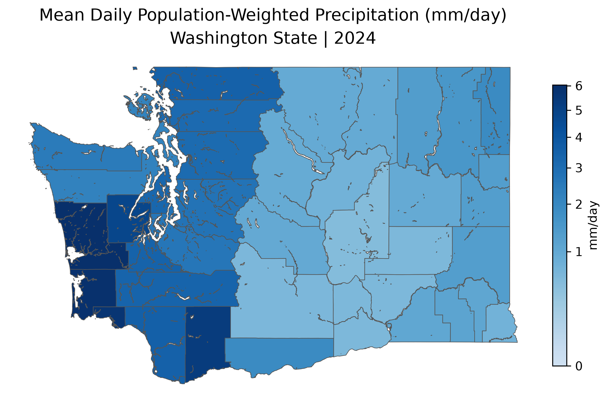
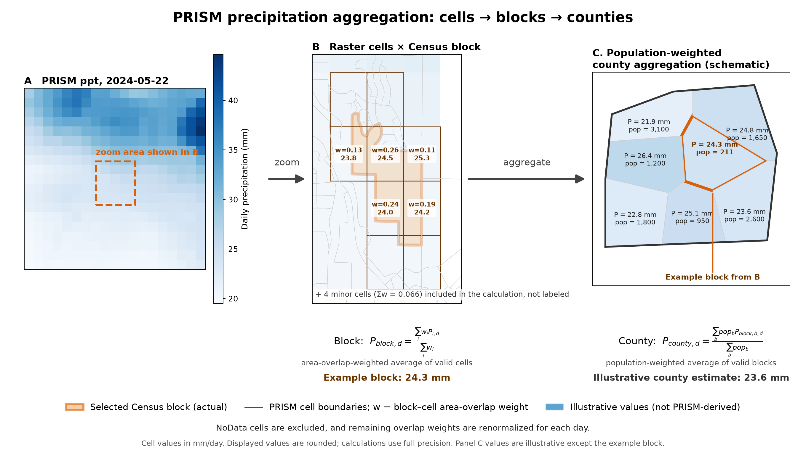

# coding-agents-prism-spaceagg-demo

A reproducible pipeline that turns daily PRISM 800 m precipitation into population-weighted county precipitation, then into annual county summaries. It also documents how AI coding agents were used to build it: `AGENTS.md`, reusable Skills, lightweight specs, automated workflows, and scientific validation.

Demonstration: **Washington State, 2024**, using 2020 Census blocks. The pipeline is configuration-driven, so years, dates, and other states can be added without changing the processing code.

## What the pipeline produces

First rows of the yearly output, `county_yearly_2024.parquet` (5 of 39 counties):

| county_geoid | year | population | days_observed | days_expected | precip_total_mm | precip_mean_mm |
|---:|---:|---:|---:|---:|---:|---:|
| 53001 | 2024 | 20,613 | 366 | 366 | 224.8 | 0.614 |
| 53003 | 2024 | 22,285 | 366 | 366 | 273.2 | 0.746 |
| 53005 | 2024 | 206,873 | 366 | 366 | 225.8 | 0.617 |
| 53007 | 2024 | 79,074 | 366 | 366 | 341.9 | 0.934 |
| 53009 | 2024 | 77,155 | 366 | 366 | 911.4 | 2.490 |

`precip_total_mm` is the annual total in mm. `precip_mean_mm` is the mean daily precipitation in mm/day.



Washington 2024 results: yearly totals range 199.6–2,208.2 mm and county means range 0.55–6.03 mm/day. Every county has 366 of 366 valid days.

## Method

1. **Input rasters.** PRISM daily total precipitation (`ppt`, mm) on a 30 arc-second grid (≈800 m), EPSG:4269, 7025 × 3105 cells, NoData −9999. Each day is a ZIP holding one GeoTIFF. Every file is checked against a reference grid before use. The original ZIPs are kept unchanged, with SHA-256 checksums recorded in a manifest.
2. **Day definition.** PRISM's daily value covers the 24 hours ending 12:00 UTC. The output keeps the PRISM file date and records that definition in the metadata.
3. **Block–cell crosswalk.** Each Census 2020 block is intersected with the PRISM cell grid. Each cell gets an area weight equal to its overlap area divided by the block's total overlap area, so weights sum to 1 per block. Overlaps of 10 m² or less are dropped. The crosswalk is 816,566 block–cell rows.

   

   *Example, 2024-05-22. A: PRISM daily precipitation cells, with the zoom area dashed. B: one Census block (orange) with the area weight `w` and cell value of each overlapping cell. `w` is the fraction of the block's retained overlap area that falls in each PRISM cell; weights sum to 1. C: a schematic county of blocks weighted by 2020 population; values are illustrative except the highlighted block.*

4. **Block value per day.** Over the valid (non-NoData) cells of each block:

   `P_block,d = Σ_c w_bc · p_c,d / Σ_c w_bc`

   The denominator uses only valid cells. Missing cells are not treated as zero.
5. **County value per day.** Population-weighted average of valid blocks:

   `P_county,d = Σ_b pop_b · P_block,d / Σ_b pop_b`

   A county's population coverage is reported separately.
6. **Yearly summary.**
   - `precip_total_mm = Σ_d P_county,d` (mm)
   - `precip_mean_mm = precip_total_mm / days_expected` (mm/day)
   - The yearly file is published only when every county has a value on every expected day. Any gap fails the whole year.
7. **QC.** Each stage has explicit checks, such as CRS and grid alignment, weight sums, population totals against the Census reference, row counts, uniqueness, and finite non-negative values. A failed check raises an error and no output is published.

## Reproduce it

### Requirements

- Conda or Miniconda
- About 7.1 GB of disk for the 2024 PRISM files, plus about 200 MB for the Census block ZIP
- Network access to `data.prism.oregonstate.edu` and `www2.census.gov`

### Steps

```bash
git clone <this repository>
cd coding-agents-prism-spaceagg-demo

# 1. Create the environment (name and packages are in environment.yaml)
conda env create -f environment.yaml
conda activate prism-spaceagg

# 2. Run the tests (offline, synthetic data)
pytest

# 3. Preview the workflow without running it
snakemake -n

# 4. Run the full pipeline
snakemake --cores 4
```

Snakemake runs every stage in order: PRISM download and validation, Census blocks, crosswalk, daily county precipitation, yearly summary, and map. Re-running `snakemake` only rebuilds what has changed. Editing a file in `src/` or `conf/` rebuilds only the stages that use it.

### Changing the study

All settings live in `conf/`. You don't need to edit code.

| To change | Edit |
|---|---|
| Year(s) | `conf/prism_ppt.yaml`, `prism.years` |
| Date range within a year | `conf/prism_ppt.yaml`, `prism.start_date` and `prism.end_date` |
| State, Census vintage, state name | `conf/census.yaml`, `census` block and `targets` |
| Crosswalk and coverage thresholds | `conf/crosswalk.yaml` |
| Data locations | `conf/datapaths.yaml` |

#### Change the year

Edit `conf/prism_ppt.yaml`:

```yaml
prism:
  years: [2023, 2024]   # one entry per year; every year is built
```

- Each year downloads about 7 GB of daily PRISM ZIPs.
- The first year in the list sets the reference grid. Every other year must match it exactly, or the run stops with a grid error.
- To limit a year to part of its calendar, set `start_date` and `end_date` (ISO dates such as `2024-03-01`). The expected days then shrink to the clipped range, and the yearly mean uses that count.
- Run `snakemake --cores 4`. Snakemake builds only the years that do not have outputs yet.

#### Change the state

Edit `conf/census.yaml`:

```yaml
census:
  state_fips: "41"        # two-digit FIPS code (41 = Oregon)
  state_name: Oregon      # used in map titles
  targets:
    - {vintage: 2020, state_fips: "41"}
  references:             # optional QC reference values; omit to skip the check
```

- `targets` lists the states to build. Each entry gets its own blocks, crosswalk, daily and yearly outputs, QC files, and map. To build two states, add two entries.
- `state_fips` is used for the Census download name (`tl_2020_41_tabblock20.zip`), so no URL needs editing.
- `references` holds the expected population and county count for QC, keyed by vintage and FIPS. If there is no entry, the check is skipped with a warning.
- Check the plan with `snakemake -n`, then run `snakemake --cores 4`. The first run downloads the state's block ZIP.

**Limits to know before you change the state:**

- The map title uses a single `state_name` from `conf/census.yaml` for every target. Build one state at a time until that is changed, or the second state's map will carry the first state's name.
- The block reader expects the 2020 TIGER column names (`STATEFP20`, `COUNTYFP20`, `GEOID20`, `POP20`). Another Census vintage needs code changes.
- The daily and yearly units and the day definition are fixed for PRISM precipitation (`ppt`, mm, 24 hours ending 12:00 UTC). Other PRISM variables need their own units and definitions, which means a new feature.

Run `pytest` after any configuration change to confirm the tests still pass.

### Repository layout

```
repository/
├── AGENTS.md                     # Project rules and scientific guardrails
├── CLAUDE.md                     # @AGENTS.md + Claude-specific workflow
├── Snakefile                     # One incremental pipeline
├── environment.yaml
├── conf/
│   ├── config.yaml
│   ├── datapaths.yaml
│   ├── prism_ppt.yaml
│   ├── census.yaml
│   └── crosswalk.yaml
├── .claude/skills/                # Reusable skills; not feature specs
├── docs/                          # Public documentation
│   ├── agent_context_guide.pdf    # Agent context guide
│   └── figures/                   # Methods figure and final county map
├── specs/
│   ├── 01-prism-download/
│   ├── 02-census-blocks/
│   ├── 03-prism-raster-validation/
│   ├── 04-prism-block-crosswalk/
│   ├── 05-county-daily-precip/
│   └── 06-county-yearly-precip/
│       ├── spec.md
│       ├── plan.md
│       ├── tasks.md
│       └── status.md
├── src/                           # Feature modules + shared QC
├── tests/                         # Focused offline tests
└── data/
    ├── raw/                       # Original PRISM/Census ZIPs
    ├── intermediate/              # Blocks, fishnet, crosswalk
    ├── metadata/                  # Manifests and QC
    └── output/                    # Daily, yearly and figures
```

`specs/status.md` summarizes all features. Each feature folder keeps its own spec, plan, tasks, and status.

## How this was built

Each feature followed the same workflow. Every feature has a spec with decisions (D#) and acceptance criteria (AC#), approved before implementation. Each spec has a plan, a task list, and a status file. The status files record validation results and deviations. See `specs/status.md` for the full timeline.

| Feature | Stage | Status |
|---|---|---|
| 01 | PRISM 2024 daily download with checksums | Complete |
| 02 | Census 2020 Washington blocks and population | Complete |
| 03 | PRISM raster inspection and grid validation | Complete |
| 04 | Fishnet, block–cell crosswalk, area weights | Complete |
| 05 | Daily population-weighted county precipitation | Complete |
| 06 | Yearly county totals, means, and map | Complete |

## Limitations and notes

- **PRISM stability:** the configured stability status is "not available". Confirm it against an official PRISM source before publishing results.
- **Low-coverage blocks:** three blocks in Washington 2020 fall below 0.99 coverage. Two have partial coverage, and one has population 0. The pipeline reports them as warnings.
- **Snakemake provenance:** the download rule's metadata was deleted during development, so Snakemake shows a provenance warning for it. The outputs are unaffected.
- **Figure in `docs/`:** the methods figure was made from the 2024-05-22 raster and the crosswalk, with a one-off script. That script is not yet part of the repository, so the figure cannot be regenerated from the repo alone.
- **Data is not committed.** `data/` and most logs are git-ignored. Re-run the pipeline to recreate outputs.

## Agent context guide

[`docs/agent_context_guide.pdf`](docs/agent_context_guide.pdf) is a field guide, "Agent Context Files: Field Guide". It explains how this repository gives a coding agent its instructions, and how each file is used.

**Files and the question each one answers**

| File | Question it answers | Scope |
|---|---|---|
| `AGENTS.md` | How do we work in this repo? Project goals, structure, tools, and guardrails. | Project-wide |
| `CLAUDE.md` | Same question for Claude Code. Imports `AGENTS.md` and adds Claude-specific workflow. | Project-wide |
| `.claude/skills/*/SKILL.md` | How do I do this kind of task? Reusable procedures, loaded when relevant. | Project-wide, on demand |
| `specs/<feature>/spec.md` | What are we building, and why? Decisions, rationale, and acceptance criteria. | Per feature |
| `specs/<feature>/plan.md` | How will we build it? Modules, data flow, and validation strategy. | Per feature |
| `specs/<feature>/tasks.md` | What is the next concrete step? A checklist linked to decisions. | Per feature |
| `specs/<feature>/status.md` | Where did we leave off? Completed work, blockers, deviations, and next step. | Per feature |

**How they are used**

- **Reading order for a new session:** `AGENTS.md` and `CLAUDE.md`, then `status.md`, then the next unchecked task in `tasks.md`, then the relevant parts of `spec.md` and `plan.md`.
- **Writing order for a new analysis:** explore the problem, draft `spec.md` and get it approved, draft `plan.md` and get it approved, create `tasks.md`, implement and validate while updating `status.md`. Any change to scientific intent goes back to `spec.md` for approval.
- **Gates:** the spec is approved before planning, and the plan is approved before coding. Tasks are written only after the plan is approved.
- **Spec-anchored approach:** the specification and the code evolve together. Findings that change scientific intent return to the spec.

**Practices the guide recommends**

- Keep `AGENTS.md` and `CLAUDE.md` short, because they load into context on every session. Put detailed procedures in Skills and feature decisions in specs.
- Keep shared rules in `AGENTS.md` and have `CLAUDE.md` import it, rather than duplicating them.
- Number each methodological decision and record its rationale. Make acceptance criteria testable, not "values look plausible".
- Record data versions and checksums, so reruns can be explained.
- Keep the spec files in version control, so `git log` shows how a feature's intent changed.
- Use one spec folder per feature. Save progress to `status.md` before clearing or compacting the session.

The guide's examples are templates. This repository's approved specifications are in `specs/`.
